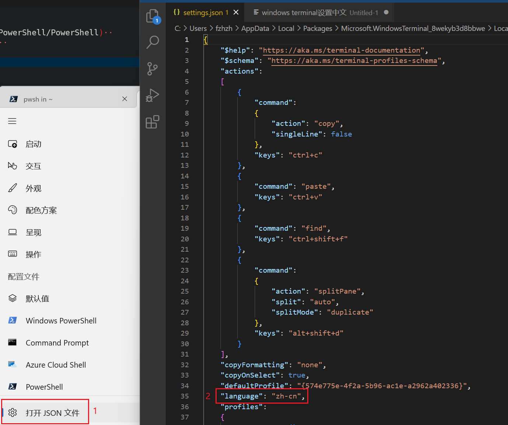
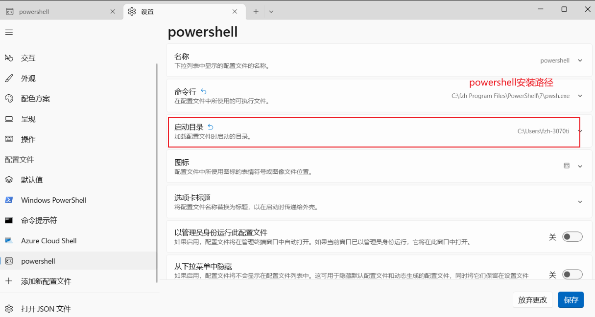

# powershell和nvim以及wsl2相关配置

#### 1.下载powershell

> 下载最新**powershell-x.x.x-win-x64.msi**  
> 查看powershell版本  
> `$host`

- [powershell下载地址](https://github.com/PowerShell/PowerShell)  

#### 2.添加powershell配置文件

> windows terminal设置为中文
> 
>
> 将powershell添加到windows terminal
> 

## 一.安装scoop

### 1.设置 PowerShell 执行策略（必须先执行）
```powershell
Set-ExecutionPolicy -ExecutionPolicy RemoteSigned -Scope CurrentUser
```

### 2.修改scoop安装的环境变量
```powershell
$env:SCOOP='C:\Scoop'
[Environment]::SetEnvironmentVariable('SCOOP', $env:SCOOP, 'User')
```

### 3.安装scoop
```powershell
iwr -useb get.scoop.sh | iex
```

### 4.添加 bucket 仓库
```powershell
scoop install git
scoop bucket add main
scoop bucket add extras
scoop bucket add versions
scoop bucket add java

[Environment]::SetEnvironmentVariable("PATH", $env:PATH + ";C:\Scoop\apps\git\current\usr\bin", "User")
```

### 5.安装软件（按分类）

**终端美化**
```powershell
scoop install posh-git oh-my-posh
```

**开发工具**
```powershell
scoop install lazygit@0.55.1
scoop hold lazygit          # 锁版本，防止 scoop update 自动升级
```

**搜索和文件管理**
```powershell
scoop install fd@10.5.2 fzf@0.75.0 PSFzf ripgrep@16.0.0 bat@0.26.1   # 版本和六章 8・9 节的 Linux 一样
scoop install yazi@26.5.6 file
scoop install ffmpeg        # 提供 ffprobe（yazi 读 mp4 等视频信息）+ 视频缩略图预览
scoop install ouch@0.8.3    # 固定 0.8.3：0.8.0〜0.8.1 压的 zip 用 7-Zip 打不开，0.6.1 以前在 Windows 压的 zip 丢文件夹
scoop hold yazi ouch fd fzf ripgrep bat   # 锁版本，防止 scoop update 自动升级
```

**编程语言 - Java**
```powershell
scoop install openjdk prince
```

**编程语言 - Node.js**
```powershell
scoop install nvm
nvm list available
nvm install 22.12.0      # 安装 LTS 最新版本
nvm use 22.12.0
```

**Claude Code**
```powershell
# 1. 设置 Git Bash 环境变量（Claude Code 需要 bash）
$gitBashPath = "C:\Scoop\apps\git\current\usr\bin\bash.exe"
Test-Path $gitBashPath

# 如果返回 False，查找正确路径
if (-not (Test-Path $gitBashPath)) {
    $scoop = if ($env:SCOOP) { $env:SCOOP } else { "$env:USERPROFILE\scoop" }

    Write-Host "Searching for bash.exe in Scoop directory..."
    $bashLocations = Get-ChildItem "$scoop\apps\git" -Recurse -Filter "bash.exe" -ErrorAction SilentlyContinue | Select-Object -ExpandProperty FullName

    if ($bashLocations) {
        Write-Host "Found bash.exe at:"
        $bashLocations | ForEach-Object { Write-Host "  $_" }

        $gitBashPath = $bashLocations | Where-Object { $_ -like "*\usr\bin\bash.exe" } | Select-Object -First 1
        Write-Host "Selected: $gitBashPath"
    } else {
        Write-Host "Git Bash not found. Please install Git first: scoop install git"
        exit
    }
}

# 验证并设置环境变量
if (Test-Path $gitBashPath) {
    Write-Host "Git Bash found at: $gitBashPath" -ForegroundColor Green

    [Environment]::SetEnvironmentVariable("CLAUDE_CODE_GIT_BASH_PATH", $gitBashPath, "User")
    $env:CLAUDE_CODE_GIT_BASH_PATH = $gitBashPath

    Write-Host "Environment variable set:"
    Write-Host "  CLAUDE_CODE_GIT_BASH_PATH = $env:CLAUDE_CODE_GIT_BASH_PATH" -ForegroundColor Cyan
} else {
    Write-Host "Error: Git Bash path not valid!" -ForegroundColor Red
}

# 2. 安装 Claude Code
npm install -g @anthropic-ai/claude-code@latest

# 3. 安装 Antigravity CLI（Google 终端编码代理，命令 agy；独立二进制，不走 npm）
irm https://antigravity.google/cli/install.ps1 | iex
# 装到 %LOCALAPPDATA%\Antigravity\
# 用法：项目目录里运行 agy → 首次弹浏览器用 Google 账号登录 → 进入交互式代理；/logout 退出登录
```

**编程语言 - Python**
```powershell
scoop install python

# 升级 pip
python -m pip install --upgrade pip

# 安装 neovim 相关包
pip install pynvim neovim pygments

# openpyxl：读写 Excel(.xlsx) 的库（scoop 只装程序、装不了库，故用 pip）
pip install openpyxl
```

**其他工具**
```powershell
# poppler 提供 pdftotext，供 Claude Code 读取 PDF
scoop install mingw graphviz poppler
```

### 6.安装 PowerShell 模块
```powershell
Install-Module -Name PowerShellGet -Force
Install-Module PSReadLine
```

### 7.生成 PowerShell 配置文件
```powershell
# 如果配置文件不存在则创建
if (!(Test-Path -Path $PROFILE)) { New-Item -Type File -Path $PROFILE -Force }

# 查看配置文件位置
echo $PROFILE

# 编辑配置文件
notepad $PROFILE
```

### 8.Microsoft.PowerShell_profile.ps1 文件内容
```powershell
# ========== 模块导入 ==========
Import-Module PSReadLine
Import-Module posh-git

# ========== 编辑模式和按键 ==========
Set-PSReadLineOption -EditMode Emacs
Set-PSReadlineKeyHandler -Key Tab -Function MenuComplete

# ========== 别名 ==========
Set-Alias -Name lg -Value lazygit

# ========== Oh My Posh 主题 ==========
oh-my-posh init pwsh --config "$env:POSH_THEMES_PATH\ys.omp.json" | Invoke-Expression

# ========== FZF 配置 ==========
Set-PsFzfOption -PSReadlineChordProvider 'Ctrl+t' -PSReadlineChordReverseHistory 'Ctrl+r'
$env:FZF_DEFAULT_OPTS = "--no-mouse"

# ========== Yazi 文件管理器 ==========
function ra {
    $tempFile = [System.IO.Path]::GetTempFileName()
    try {
        & yazi --cwd-file="$tempFile" $args
        if (Test-Path -LiteralPath $tempFile) {
            $lastDir = Get-Content -LiteralPath $tempFile -Raw
            if ($lastDir) {
                $lastDir = $lastDir.Trim()
            }
            if ($lastDir -and (Test-Path -LiteralPath $lastDir)) {
                $currentLocation = (Get-Location).Path
                if ($lastDir -ne $currentLocation) {
                    Set-Location -LiteralPath $lastDir
                }
            }
        }
    }
    finally {
        if (Test-Path -LiteralPath $tempFile) {
            Remove-Item -LiteralPath $tempFile -Force
        }
    }
}

# ========== Claude Code：标签页固定显示当前文件夹名 ==========
function cld {
    $env:CLAUDE_CODE_DISABLE_TERMINAL_TITLE = "1"
    $Host.UI.RawUI.WindowTitle = Split-Path -Leaf (Get-Location)
    claude @args
}

# ========== 告诉 Windows Terminal 当前目录（分割窗格时沿用） ==========
# 要放在 oh-my-posh init 那行后面（放前面会被 oh-my-posh 覆盖）
# 还要配合 11 节 wt-keys.json 里的 "splitMode": "duplicate"，两处都有才生效
$__ompPrompt = $function:prompt
function prompt {
    $loc = $executionContext.SessionState.Path.CurrentLocation
    $osc = ""
    if ($loc.Provider.Name -eq "FileSystem") {
        $osc = "$([char]27)]9;9;`"$($loc.ProviderPath)`"$([char]27)\"
    }
    $osc + (& $__ompPrompt)
}
```

**cld 的用法**

- 用 `cld` 代替 `claude` 启动。参数原样传给 `claude`，例：`cld --dangerously-skip-permissions`。
- 目的：Claude Code 默认会按对话内容改写终端标签页的标题，看不出在哪个项目。`cld` 先关掉这个改写，再把标题设成当前文件夹名。
- 在项目根目录执行。在子文件夹里执行的话，标题是子文件夹名。
- 不叫 `cc`：装了 mingw 时 `cc` 是 C 编译器，函数会把它盖掉。

### 9.常用命令
```powershell
# 列出所有按键绑定
Get-PSReadLineKeyHandler

# 查看环境变量
Get-ChildItem env:

# 查看命令位置
Get-Command yazi
Get-Command lazygit
```

### 10.实现右键菜单
```powershell
git clone https://github.com/LittleNewton/Open_Windows_Terminal_Here.git
cd Open_Windows_Terminal_Here/src
.\install.ps1 mini
```

### 11.Windows Terminal 快捷键配置

快捷键放在本文件夹的 [wt-keys.json](wt-keys.json)（`actions` 和 `keybindings` 两块），用脚本 [wt-apply-keys.ps1](wt-apply-keys.ps1) 覆盖到 Windows Terminal 的 `settings.json`。
只换这两块，`profiles`・`defaultProfile`・配色等每台电脑自己的设置不动。不备份：这台电脑上自己加过的快捷键会被覆盖。

**覆盖快捷键**（PowerShell 7，在 fzh_markdown 的 `windows` 文件夹执行；Windows Terminal 开着也可以，会自动重新读取）
```powershell
pwsh -File .\wt-apply-keys.ps1
```

期待的输出：`已覆盖：…settings.json（actions 16 条、keybindings 75 条）`

**改快捷键**：只改 [wt-keys.json](wt-keys.json)，再执行一次上面的命令。

**wt-keys.json 的结构**
- `actions`：定义命令，每个命令有唯一的 `id`
- `keybindings`：通过 `id` 绑定快捷键
- `"id": null`：禁用该快捷键的默认行为
- `"splitMode": "duplicate"`：分割时复制当前窗格（profile 和当前目录）；目录要靠 8 节 profile 里的 prompt 包装告诉 Windows Terminal

**快捷键速查表**

| 功能 | 快捷键 |
|------|--------|
| 上一个标签页 | `Ctrl+Shift+P` |
| 下一个标签页 | `Ctrl+Shift+N` |
| 关闭窗格 | `Ctrl+Shift+Q` |
| 拆分窗格（下，沿用当前目录） | `Ctrl+Shift+O` |
| 拆分窗格（右，沿用当前目录） | `Ctrl+Shift+E` |
| 切换窗格焦点 | `Ctrl+Tab` |
| 调整窗格大小 | `Ctrl+Shift+I/K/J/L` |
| 粘贴 | `Ctrl+Shift+V` |
| 查找 | `Ctrl+Shift+F` |
| 全屏 | `F10` |
| 窗格缩放 | `Ctrl+Shift+Z` |

### 12.配置文件位置

**yazi配置文件**

配置源仓库：`https://github.com/fzhzhen1987/yazi_v26.5.6.git`

```powershell
# 配置在 windows 分支根目录，直接把该分支克隆成配置目录
# 目标目录必须不存在；已有旧配置直接删掉：
#   Remove-Item -Recurse -Force "$env:APPDATA\yazi\config"
git clone -b windows --single-branch https://github.com/fzhzhen1987/yazi_v26.5.6.git "$env:APPDATA\yazi\config"

# 装社区插件（package.toml 已记录依赖：mime-ext）
cd "$env:APPDATA\yazi\config"
ya pkg install

# 查看配置目录（确认已克隆完整）
explorer "$env:APPDATA\yazi\config"
```

**lazygit配置文件位置**（`lazygit --print-config-dir` 显示的目录）
```
C:\Users\用户名\AppData\Local\lazygit
```

**tig配置文件位置（%USERPROFILE%）**
```
C:\Users\用户名\
```

## 三.安装nerd字体

Windows 和 Linux 都用同一个字体 SauceCodePro Nerd Font（v3.3.0）。下面的命令把它下载、解压、装给当前用户，不用双击。
WSL 和 ssh 连的 Linux 是 Windows Terminal 用 Windows 的字体显示的，只装 Windows 那边就能正常显示；Linux 本机开图形终端时才用到 Linux 这边的字体。

**Windows**（PowerShell，不用管理员）
```powershell
# 1. 下载并解压到「下载」文件夹
$zip = "$env:USERPROFILE\Downloads\SourceCodePro.zip"
$dir = "$env:USERPROFILE\Downloads\SourceCodePro"
Invoke-WebRequest -Uri "https://github.com/ryanoasis/nerd-fonts/releases/download/v3.3.0/SourceCodePro.zip" -OutFile $zip
Expand-Archive -Path $zip -DestinationPath $dir -Force

# 2. 装给当前用户：复制到用户的字体文件夹，再登记到注册表（已经有这个文件就不复制）
$fontDir = "$env:LOCALAPPDATA\Microsoft\Windows\Fonts"
New-Item -ItemType Directory -Force $fontDir | Out-Null
$dst = Join-Path $fontDir "SauceCodeProNerdFont-Regular.ttf"
if (!(Test-Path $dst)) { Copy-Item "$dir\SauceCodeProNerdFont-Regular.ttf" $dst }
New-ItemProperty -Path "HKCU:\SOFTWARE\Microsoft\Windows NT\CurrentVersion\Fonts" -Name "SauceCodePro NF (TrueType)" -Value $dst -PropertyType String -Force | Out-Null

# 3. 确认（新开一个 PowerShell 执行，期待输出 SauceCodePro NF）
Add-Type -AssemblyName System.Drawing; (New-Object System.Drawing.Text.InstalledFontCollection).Families.Name | Where-Object { $_ -like "SauceCodePro*" }
```

装完后在 Windows Terminal 的「设置 → 默认值 → 外观 → 字体」选 `SauceCodePro NF`（新开的 Windows Terminal 才会出现在列表里）。

**Linux**（Ubuntu，x86_64 和 ARM 一样）
```shell
# 1. 下载并解压到 ~/memo
mkdir -p ~/memo && cd ~/memo
wget https://github.com/ryanoasis/nerd-fonts/releases/download/v3.3.0/SourceCodePro.zip
unzip -o SourceCodePro.zip -d SourceCodePro

# 2. 装给当前用户：放进用户的字体文件夹，再刷新字体缓存（fontconfig 提供 fc-cache・fc-list）
sudo apt install -y fontconfig
mkdir -p ~/.local/share/fonts
cp SourceCodePro/SauceCodeProNerdFont-Regular.ttf ~/.local/share/fonts/
fc-cache -f ~/.local/share/fonts
cd ~

# 3. 确认（期待：SauceCodePro Nerd Font,SauceCodePro NF）
fc-list : family | grep SauceCodePro
```

## 四.nvim配置

### 1.其他必须操作

Windows 上不装 nvim（体验不好）。写代码用 WSL2 Ubuntu 里的 nvim，装法见六章 13 节。

nvm（Node.js）和 python・pynvim 已在一章 5 节装好，这里不用再装。

## 五.WSL2 安装与配置

WSL2 本身用六章 1 节的 `wsl --install` 装（会一起开好需要的 Windows 功能）。

### 1.磁盘管理（扩容/缩小）
```powershell
# 扩容（例：512G）
diskpart
DISKPART> Select vdisk file="C:\路径\ext4.vhdx"
DISKPART> expand vdisk maximum=512000
DISKPART> exit

# 缩小（需先在 WSL 内执行 zerofree）
wsl --shutdown
diskpart
DISKPART> Select vdisk file="C:\路径\ext4.vhdx"
DISKPART> compact vdisk
DISKPART> exit
```

## 六.WSL2 Ubuntu（22.04/24.04）

### 1.安装
```powershell
wsl --install -d Ubuntu-22.04
# 或
wsl --install -d Ubuntu-24.04
wsl --update
```

### 2.初始用户配置（以 root 执行）
```shell
wsl -u root

# 设置 root 密码
passwd root

apt update
apt install -y git zsh sudo

groupadd -g 1008 mav
useradd -u 2018 -M -g mav -s /bin/zsh mav
rm -rf /home/mav

cd /home
git clone https://github.com/fzhzhen1987/feng_LG.git mav

chown -R mav:mav /home/mav
chmod 755 /home/mav

usermod -aG sudo mav
echo 'mav:2' | chpasswd
# 用独立的 sudoers.d 文件，避免直接改 /etc/sudoers 写错锁死 sudo
echo 'mav ALL=(ALL) NOPASSWD: ALL' > /etc/sudoers.d/mav
chmod 440 /etc/sudoers.d/mav
visudo -cf /etc/sudoers.d/mav

# 设置默认用户
if [ -f /etc/wsl.conf ]; then
    if grep -q "^\[user\]" /etc/wsl.conf; then
        sed -i '/^\[user\]/,/^\[/{s/^default=.*/default=mav/}' /etc/wsl.conf
    else
        echo -e "\n[user]\ndefault=mav" >> /etc/wsl.conf
    fi
else
    echo -e "[user]\ndefault=mav" > /etc/wsl.conf
fi

# 删除用户（可选）
# sudo killall -u test
# sudo deluser --remove-home test

exit
```

```powershell
wsl --shutdown
```

### 3.系统更新和基础依赖

ARM（aarch64，例：甲骨文云 A1、树莓派）没有 i386，跳过下面「添加 i386 架构支持」的两行，4 节的 32 位库也不装。确认 CPU：`uname -m`。

```shell
sudo apt update && sudo apt upgrade -y

# 添加 i386 架构支持
sudo dpkg --add-architecture i386
sudo apt update
```

### 4.安装开发工具
```shell
# 编译工具链
sudo apt install -y build-essential gcc g++ make cmake
sudo apt install -y git tig bc flex bison openssh-server
sudo apt install -y libssl-dev libncurses-dev libevent-dev pkg-config

# 文件处理工具
sudo apt install -y file rsync kmod cpio unzip bzip2 zip
sudo apt install -y wget curl tofrodos

# PDF 文本提取（供 Claude Code 用 pdftotext 读 PDF）
sudo apt install -y poppler-utils

# 设备树和补丁工具
sudo apt install -y device-tree-compiler patch

# Python 环境
sudo apt install -y python3 python3-pip python3-full python3-venv

# 32 位库（交叉编译用）
sudo apt install -y libc6:i386 libncurses6:i386 libstdc++6:i386 zlib1g:i386
```

clangd（C/C++ 的补全・跳转用，nvim 的 LSP）固定 18。24.04 自带的就是 18；22.04 自带的是 14，要加 LLVM 官方的 apt 源装 18。

```shell
# Ubuntu 24.04
sudo apt install -y clangd

# Ubuntu 22.04
curl -fsSL https://apt.llvm.org/llvm-snapshot.gpg.key | sudo tee /etc/apt/trusted.gpg.d/apt.llvm.org.asc >/dev/null
echo "deb http://apt.llvm.org/$(lsb_release -cs)/ llvm-toolchain-$(lsb_release -cs)-18 main" | sudo tee /etc/apt/sources.list.d/llvm-18.list
sudo apt update && sudo apt install -y clangd-18
sudo ln -sfn /usr/bin/clangd-18 /usr/local/bin/clangd

# 确认（期待：clangd version 18.x）
clangd --version | head -1
```

### 5.配置 locale
```shell
sudo apt install -y locales
sudo sed -i 's/^# en_US.UTF-8/en_US.UTF-8/' /etc/locale.gen
sudo sed -i 's/^# zh_CN.UTF-8/zh_CN.UTF-8/' /etc/locale.gen
sudo sed -i 's/^# ja_JP.UTF-8/ja_JP.UTF-8/' /etc/locale.gen
sudo locale-gen
```

### 6.安装 Oh My Zsh
```shell
su - mav
cd /home/mav/memo
chmod +x install.sh
./install.sh
cd ~
git checkout .zshrc
```

### 7.安装 Zsh 插件
```shell
git clone https://github.com/zsh-users/zsh-syntax-highlighting.git \
  ${ZSH_CUSTOM:-~/.oh-my-zsh/custom}/plugins/zsh-syntax-highlighting

git clone https://github.com/zsh-users/zsh-autosuggestions.git \
  ${ZSH_CUSTOM:-~/.oh-my-zsh/custom}/plugins/zsh-autosuggestions

git clone --depth=1 https://github.com/romkatv/powerlevel10k.git \
  ${ZSH_CUSTOM:-~/.oh-my-zsh/custom}/themes/powerlevel10k
```

### 8.安装 fzf
```shell
# 固定 v0.75.0（和 Windows 一样）
# 已经有 ~/.fzf 时不用 clone，换版本：cd ~/.fzf && git fetch --depth 1 origin tag v0.75.0 && git checkout v0.75.0 && ./install --bin && cd ~
git clone --depth 1 --branch v0.75.0 https://github.com/junegunn/fzf.git ~/.fzf
~/.fzf/install
# Enable fuzzy auto-completion? Yes
# Enable key bindings? Yes
# Update shell configuration? No

git checkout .zshrc
```

### 9.安装命令行工具

ripgrep 用官方压缩包（官方 deb 只有 x86_64 版），bat・fd 用官方 deb。版本和 Windows 一样。下面的命令按 CPU 自动选文件，x86_64 和 ARM（aarch64）都能直接用。

```shell
cd ~/memo
ARCH=$(dpkg --print-architecture)   # amd64 或 arm64

# ripgrep 16.0.0：先删 Ubuntu 自带的，再装到 /usr/local/bin
sudo apt remove -y ripgrep
wget https://github.com/BurntSushi/ripgrep/releases/download/16.0.0/ripgrep-16.0.0-$(uname -m)-unknown-linux-musl.tar.gz
tar xzf ripgrep-16.0.0-$(uname -m)-unknown-linux-musl.tar.gz
sudo install -m 755 ripgrep-16.0.0-$(uname -m)-unknown-linux-musl/rg /usr/local/bin/rg

# bat 0.26.1・fd 10.5.2：先删 Ubuntu 的 fd-find；装完锁住，免得 apt upgrade 换成 Ubuntu 的版本
sudo apt remove -y fd-find
wget https://github.com/sharkdp/bat/releases/download/v0.26.1/bat_0.26.1_${ARCH}.deb
wget https://github.com/sharkdp/fd/releases/download/v10.5.2/fd_10.5.2_${ARCH}.deb
sudo apt-mark unhold bat fd   # 换版本时先解锁；第一次装时显示 Unable to locate package fd，是正常的（还没装）
sudo dpkg -i bat_0.26.1_${ARCH}.deb fd_10.5.2_${ARCH}.deb
sudo apt-mark hold bat fd

# 确认（期待：/usr/local/bin/rg、ripgrep 16.0.0、bat 0.26.1、fd 10.5.2）
hash -r; which rg && rg --version | head -1 && bat --version && fd --version
```

### 10.安装文件管理器和工具

下面的下载地址都是 x86_64 用的。ARM（aarch64）上把文件名换掉：yazi・ouch 的 `x86_64-unknown-linux-musl` → `aarch64-unknown-linux-musl`，lazygit 的 `Linux_x86_64` → `Linux_arm64`。

```shell
cd ~/memo
mkdir -p ~/.local/bin

# yazi
sudo apt install -y nkf xclip
wget https://github.com/sxyazi/yazi/releases/download/v26.5.6/yazi-x86_64-unknown-linux-musl.zip
unzip -o yazi-x86_64-unknown-linux-musl.zip
mv yazi-x86_64-unknown-linux-musl/yazi ~/.local/bin/
mv yazi-x86_64-unknown-linux-musl/ya ~/.local/bin/

# lazygit
wget https://github.com/jesseduffield/lazygit/releases/download/v0.55.1/lazygit_0.55.1_Linux_x86_64.tar.gz
tar xzvf lazygit_0.55.1_Linux_x86_64.tar.gz
mv lazygit ~/.local/bin/

# ouch（固定 0.8.3，和 Windows 一样：0.8.0〜0.8.1 压的 zip 用 7-Zip 打不开）
wget https://github.com/ouch-org/ouch/releases/download/0.8.3/ouch-x86_64-unknown-linux-musl.tar.gz
tar xzf ouch-x86_64-unknown-linux-musl.tar.gz
mv ouch-x86_64-unknown-linux-musl/ouch ~/.local/bin/
chmod +x ~/.local/bin/ouch

# claude code
curl -fsSL https://claude.ai/install.sh | bash -s latest

# Antigravity CLI（Google 终端编码代理，命令 agy；独立二进制，不走 npm，无需 Node）
curl -fsSL https://antigravity.google/cli/install.sh | bash
# 装到 ~/.local/bin
# 用法：项目目录里运行 agy → 首次走浏览器 Google 登录（SSH/远程会打印授权 URL）→ 交互式代理；/logout 退出
```

#### Claude Code 配置

`~/.claude/settings.json` 加 `"tui": "default"`：

- `default` = 内联，对话留在 scrollback（要这个）
- `fullscreen` = 全屏（备用屏），退出后对话消失、找不回

会话内可临时切换：`/tui default` / `/tui fullscreen`。

### 11.安装 tmux 与 rainbarf（tmux 状态栏）
```shell
cd ~/memo

# 下载并编译 tmux 3.7（依赖已在第 4 节装好）
wget https://github.com/tmux/tmux/releases/download/3.7/tmux-3.7.tar.gz
tar -zxf tmux-3.7.tar.gz
cd tmux-3.7
./configure
make
sudo make install

# rainbarf(tmux 状态栏)
cd ~/memo
git clone https://github.com/creaktive/rainbarf.git
cd rainbarf
sudo apt install -y libmodule-build-perl
perl Build.PL
./Build test
sudo ./Build install
```

### 12.安装 GNU Global（gtags，固定版本 6.6.7，源码编译）
> 从 GNU 源码编译指定版本，各端版本一致（不用 apt——apt 版本随发行版变、不固定）。
> 编译依赖 build-essential / libncurses-dev 已在前面步骤安装，无需重复。
> 注：GNU GLOBAL 自 6.6.5 起弃用内置 C++ 解析器，C/C++ 解析交给 universal-ctags。
```shell
cd ~/memo
# 下载 + 编译安装 固定版本 6.6.7
wget https://ftp.gnu.org/pub/gnu/global/global-6.6.7.tar.gz
tar xzvf global-6.6.7.tar.gz
cd global-6.6.7
./configure
make
sudo make install

# 确认版本（应显示 6.6.7）
global --version

# gtags 配置用同一版本的
cp ~/memo/global-6.6.7/gtags.conf ~/.gtags.conf
```

### 13.安装 Neovim（固定版本 v0.12.6）

用官方的压缩包（tar.gz）装到 `~/.local/opt/`，在 `~/.local/bin/nvim` 放链接。不用 AppImage，所以不需要 FUSE；x86_64 和 ARM（aarch64）都能用同一组命令。
不用 apt 的 neovim：apt 的版本跟着发行版走（24.04 是 0.9.5），配置要 0.11 以上。

```shell
# 1. 下载并解压（按 CPU 选文件：x86_64 → nvim-linux-x86_64，aarch64 → nvim-linux-arm64）
case "$(uname -m)" in x86_64) NV_ARCH=x86_64 ;; aarch64) NV_ARCH=arm64 ;; esac
mkdir -p ~/.local/opt ~/.local/bin && cd ~/.local/opt
wget https://github.com/neovim/neovim/releases/download/v0.12.6/nvim-linux-${NV_ARCH}.tar.gz
tar xzf nvim-linux-${NV_ARCH}.tar.gz && rm nvim-linux-${NV_ARCH}.tar.gz
rm -rf nvim-0.12.6 && mv nvim-linux-${NV_ARCH} nvim-0.12.6
ln -sfn ~/.local/opt/nvim-0.12.6/bin/nvim ~/.local/bin/nvim
cd ~

# 2. 确认用的是这个 nvim（期待：~/.local/bin/nvim 和 NVIM v0.12.6）
which nvim && nvim --version | head -1

# 3. 拿配置
mkdir -p ~/.config
git clone https://github.com/fzhzhen1987/nvim.git ~/.config/nvim

# 4. 装插件（lazy.nvim 第一次会自动装自己；telescope-fzf-native 会自动 make）
nvim --headless "+Lazy! sync" +qa

# 5. 编译 LeaderF 的 C 扩展（gtags 查找用；不编译也能用，只是慢）
cd ~/.local/share/nvim/lazy/LeaderF && ./install.sh && cd ~
```

- `which nvim` 显示的不是 `~/.local/bin/nvim` 时：`~/.local/bin` 不在 PATH 里，或排在 `/usr/bin` 后面。先 `source ~/.zshrc`（feng_LG 的 `.zshrc` 已把 `~/.local/bin` 放在前面）。
- treesitter 的解析器（`config/plugins.lua` 里 `ensure_installed` 列的 15 种）在第一次打开文件时自动编译，约 1 分钟，等它跑完就行。
- 从旧版 nvim 升级上来时，旧的解析器不会自动重编，高亮会报 `Invalid node type`。打开任意一个 `.c` 文件，执行下面的命令强制重编：

```vim
:TSInstall! bash c cpp rust diff dockerfile make markdown lua regex devicetree kconfig gitcommit json yaml
```

### 14.配置 yazi
```shell
# 配置在 linux 分支根目录，直接把该分支克隆成 ~/.config/yazi
# 目标目录须不存在；已有旧配置直接删掉：
#   rm -rf ~/.config/yazi
git clone -b linux --single-branch https://github.com/fzhzhen1987/yazi_v26.5.6.git ~/.config/yazi
```

### 15.安装 Python 包

**Ubuntu 22.04**
```shell
python3 -m pip install --user --upgrade pip
pip3 install --user --upgrade pynvim neovim pygments

# openpyxl：读写 Excel(.xlsx) 的库（apt 系统包，22.04/24.04 通用）
sudo apt install -y python3-openpyxl
```

**Ubuntu 24.04**
```shell
sudo apt install -y pipx python3-full
pipx ensurepath
pipx install pynvim
pipx install pygments

# openpyxl：读写 Excel(.xlsx) 的库（库不是应用，pipx 不适用；用 apt 系统包）
sudo apt install -y python3-openpyxl
```

### 16.完成配置
```shell
cd ~
git checkout .zshrc
source ~/.zshrc
```

### 17.更新 home 配置仓库到最新（不清除未跟踪文件）

> /home/mav 是 feng_LG 仓库的 checkout。memo/、Yocto/ 等未跟踪文件绝不能误删。
> 铁律：只用 fetch + reset/merge，**绝对不用 `git clean`**。

```shell
cd ~
git fetch origin

# 二选一：
#   方式A 合并远程（保留本地提交，可能冲突，逐个解决）
git merge origin/master
#   方式B 以远程为准（丢弃本地提交，只动被跟踪文件）
git reset --hard origin/master

# ↑ 两种都不会碰 memo/、Yocto/ 等未跟踪文件。
#   千万别执行 git clean —— 那才会删未跟踪文件！
```

#### 用 Claude Code 自动完成（跳过逐步确认）
```shell
claude --dangerously-skip-permissions
```

跳过权限弹窗后，唯一防线是 `~/.claude/CLAUDE.md` 里的规矩。重装后，先把旧电脑上的这个文件复制过来，再用这条命令。

## 九.为拯救者安装工具箱

```shell
scoop install extras/lenovolegiontoolkit
```

## 十.VSCode Markdown + PlantUML 环境配置

### 1.前提条件
确保已通过 scoop 安装以下软件（见第一章）：
- openjdk（PlantUML 运行需要）
- graphviz（PlantUML 绘图需要）

```powershell
# 验证安装
java -version
dot -V
```

### 2.安装 VSCode 插件

| 插件名 | 插件 ID | 用途 |
|--------|---------|------|
| PlantUML | `jebbs.plantuml` | 提供 plantuml.jar 和语法高亮 |
| Markdown Preview Enhanced | `shd101wyy.markdown-preview-enhanced` | 增强预览，支持内嵌 PlantUML |

### 3.生成 plantumlJarPath 配置行（用户名 / 版本号 / \\ 自动处理）

```powershell
# 自动拼好可直接粘进 settings.json 的整行
$jar = (Get-ChildItem "$env:USERPROFILE\.vscode\extensions\jebbs.plantuml-*\plantuml.jar" | Select-Object -First 1).FullName
$line = '"markdown-preview-enhanced.plantumlJarPath": "' + $jar.Replace('\','\\') + '",'
$line                  # 打印出来看
$line | Set-Clipboard  # 同时复制到剪贴板，待会儿直接 Ctrl+V
```

输出示例（用户名已是你真实的，反斜杠已转义为 \\）：
```
"markdown-preview-enhanced.plantumlJarPath": "C:\\Users\\mav\\.vscode\\extensions\\jebbs.plantuml-2.18.1\\plantuml.jar",
```

### 4.配置 settings.json

按 `Ctrl+Shift+P` → `Preferences: Open User Settings (JSON)`

```json
{
    // plantumlJarPath：用上面第 3 步生成的那行替换本行（已含真实用户名和 \\）
    "markdown-preview-enhanced.plantumlJarPath": "C:\\Users\\用户名\\.vscode\\extensions\\jebbs.plantuml-2.18.1\\plantuml.jar",
    "markdown-preview-enhanced.previewMode": "Multiple Previews",
    "markdown-preview-enhanced.automaticallyShowPreviewOfMarkdownBeingEdited": false,
    "markdown-preview-enhanced.enableLinkify": false,
    "markdown-preview-enhanced.breakOnSingleNewLine": true,
    "markdown-preview-enhanced.enableTypographer": true,
    "markdown-preview-enhanced.previewTheme": "github-light.css",
    "security.workspace.trust.enabled": false
}
```

配置项说明：

| 配置项 | 值 | 作用 |
|--------|-----|------|
| `enableLinkify` | `false` | 关闭"纯文本 URL 自动识别为链接"，只有显式 `[文本](url)` 或 `<url>` 才变链接 |
| `breakOnSingleNewLine` | `true` | 单换行即换行（MPE 默认值，显式写出） |
| `enableTypographer` | `true` | 智能标点替换（`--` → —、`...` → …、`(c)` → © 等；代码块内不受影响） |
| `previewTheme` | `github-light.css` | 预览主题贴近 GitHub 网页显示效果 |

### 5.配置快捷键 keybindings.json（可选）

按 `Ctrl+Shift+P` → `Preferences: Open Keyboard Shortcuts (JSON)`

```json
[
    {
        "key": "ctrl+shift+v",
        "command": "markdown-preview-enhanced.openPreviewToTheSide",
        "when": "editorLangId == markdown"
    }
]
```

### 6.自定义预览样式（解除表格宽度限制）

MPE 默认给预览区加了约 980px 的最大宽度限制，宽表格会被压缩或出现横向滚动条。通过自定义 LESS 让预览区占满整个窗口宽度即可解决。

**操作步骤**：

1. 按 `Ctrl+Shift+P` 打开命令面板
2. 输入并执行：`Markdown Preview Enhanced: Customize Css`
3. 在自动打开的 `style.less` 文件中追加以下内容：

```less
.markdown-preview.markdown-preview {
    /* 取消默认的最大宽度限制，使其占满整个预览窗口宽度 */
    max-width: 100% !important;

    /* 保留一定的左右内边距，避免文字/表格贴边缘 */
    padding-left: 64px !important;
    padding-right: 64px !important;
}
```

**说明**：

- `style.less` 位于 `C:\Users\用户名\.crossnote\style.less`，是 MPE 的全局自定义样式入口
- 选择器重复写两次 `.markdown-preview.markdown-preview` 是为了提升 CSS 优先级，配合 `!important` 稳定覆盖主题默认样式
- 左右 `padding` 可按显示器宽度和个人喜好调整：32px（紧凑）/ 48px（平衡）/ 64px（舒展）/ 80px（宽松）。注意 padding 越大，表格可用空间越小，过大可能让宽表格重新出现滚动条
- 保存后预览会自动刷新，无需重启 VSCode

### 7.使用方法

**打开预览**：`Ctrl+Shift+V` 或右键 → `Markdown Preview Enhanced: Open Preview to the Side`

**编写 PlantUML**：
````markdown

````

### 8.导出自包含 HTML（发给他人也能显示图片）

默认导出的 HTML 里图片是外链，单独把 HTML 发给别人会显示不出来。在 markdown **文件最顶部**加一段 front-matter，把本地图片内嵌成 base64，生成自包含单文件：

```yaml
---
html:
  embed_local_images: true
  offline: true
---
```

然后在预览里**右键 → HTML → HTML (offline)** 导出。

- `embed_local_images: true`：引用的本地 png/jpg 全部以 base64 内嵌进 HTML；
- `offline: true`：样式/脚本一并本地化，不依赖联网/CDN；
- PlantUML 图本身就是内联渲染进 HTML 的，不受影响。

→ 导出的 `.html` 单文件直接发给对方，双击就能看到图，不用再附带图片文件夹。

### 9.故障排除

**plantuml.jar 找不到**：确认 `plantumlJarPath` 路径正确，插件更新后版本号会变化

**图表渲染失败**：运行 `java -version` 和 `dot -V` 确认依赖已安装

## 十一.Windows 语言与输入法配置

### 1. 语言管理

#### 1.1 查看当前语言列表

```powershell
Get-WinUserLanguageList | Format-List LanguageTag, LocalizedName, InputMethodTips
```

#### 1.2 删除所有语言（重置为干净状态）

```powershell
# 创建只包含英语的新列表，清除所有其他语言
$newList = New-WinUserLanguageList en-US
Set-WinUserLanguageList $newList -Force

# 确认清理结果
Get-WinUserLanguageList | Format-List LanguageTag, LocalizedName, InputMethodTips
```

#### 1.3 添加语言

**添加简体中文（微软拼音）**
```powershell
$langList = Get-WinUserLanguageList
$langList.Add("zh-Hans-CN")
Set-WinUserLanguageList $langList -Force
```

**添加日语**
```powershell
$langList = Get-WinUserLanguageList
$langList.Add("ja")
Set-WinUserLanguageList $langList -Force
```

#### 1.4 修改显示语言

Windows 显示语言由语言列表的**第一个语言**决定。

**设置中文为显示语言**
```powershell
$langList = New-WinUserLanguageList zh-Hans-CN
$langList.Add("en-US")
$langList.Add("ja")  # 可选
Set-WinUserLanguageList $langList -Force
```

**设置英语为显示语言**
```powershell
$langList = New-WinUserLanguageList en-US
$langList.Add("zh-Hans-CN")
$langList.Add("ja")  # 可选
Set-WinUserLanguageList $langList -Force
```

**设置日语为显示语言**
```powershell
$langList = New-WinUserLanguageList ja
$langList.Add("zh-Hans-CN")
$langList.Add("en-US")
Set-WinUserLanguageList $langList -Force
```

> **注意**: 修改显示语言后需要**注销或重启**才能生效。

#### 1.5 删除特定语言

**步骤 1：查看当前语言列表和索引**
```powershell
$langList = Get-WinUserLanguageList
$langList | ForEach-Object { $i = 0 } { Write-Host "[$i] $($_.LanguageTag) - $($_.LocalizedName)"; $i++ }
```

输出示例：
```
[0] zh-Hans-CN - 简体中文(中国大陆)
[1] en-US - 英语(美国)
[2] ja - 日语
```

**步骤 2：删除指定索引的语言**
```powershell
$langList = Get-WinUserLanguageList
$langList.RemoveAt(1)  # 索引号从 0 开始
Set-WinUserLanguageList $langList -Force
```

**步骤 3：确认删除结果**
```powershell
Get-WinUserLanguageList | Format-List LanguageTag, LocalizedName
```

> **注意**：索引号每次可能不同，删除前务必先确认。删除索引 0 的语言会改变 Windows 显示语言。

---

### 2. 键盘布局配置

> 适用于：日语配列笔记本，让中文/英文输入法也使用日语键盘布局（标点位置）

| 功能 | 说明 |
|------|------|
| 中文输入法 → 日语键盘布局 | 中文输入时标点位置与日语一致 |
| 英文输入法 → 日语键盘布局 | 英文输入时标点位置与日语一致 |
| CapsLock → Ctrl | 将 CapsLock 键改为 Ctrl 键 |

#### 2.1 创建 Substitutes 注册表键

```powershell
if (!(Test-Path "HKCU:\Keyboard Layout\Substitutes")) {
    New-Item -Path "HKCU:\Keyboard Layout" -Name "Substitutes" -Force
}

# 确认
Test-Path "HKCU:\Keyboard Layout\Substitutes"  # 返回 True 表示成功

# 回退
# Remove-Item -Path "HKCU:\Keyboard Layout\Substitutes" -Force
```

#### 2.2 添加中文键盘映射

让中文输入法 (00000804) 使用日语键盘布局 (00000411)

```powershell
Set-ItemProperty -Path "HKCU:\Keyboard Layout\Substitutes" -Name "00000804" -Value "00000411" -Force

# 确认
Get-ItemProperty "HKCU:\Keyboard Layout\Substitutes"  # 应显示 00000804 : 00000411

# 回退
# Remove-ItemProperty -Path "HKCU:\Keyboard Layout\Substitutes" -Name "00000804" -Force
```

#### 2.3 添加英文键盘映射

让英文输入法 (00000409) 使用日语键盘布局 (00000411)

```powershell
Set-ItemProperty -Path "HKCU:\Keyboard Layout\Substitutes" -Name "00000409" -Value "00000411" -Force

# 确认
Get-ItemProperty "HKCU:\Keyboard Layout\Substitutes"
# 应显示：00000804 : 00000411 和 00000409 : 00000411

# 回退
# Remove-ItemProperty -Path "HKCU:\Keyboard Layout\Substitutes" -Name "00000409" -Force
```

#### 2.4 CapsLock 改为 Ctrl（需要管理员权限）

```powershell
$hexValue = "00,00,00,00,00,00,00,00,02,00,00,00,1d,00,3a,00,00,00,00,00"
$binaryValue = $hexValue.Split(',') | ForEach-Object { [byte]('0x' + $_) }
Set-ItemProperty -Path "HKLM:\SYSTEM\CurrentControlSet\Control\Keyboard Layout" -Name "Scancode Map" -Value $binaryValue -Type Binary -Force

# 确认
Get-ItemProperty -Path "HKLM:\SYSTEM\CurrentControlSet\Control\Keyboard Layout" -Name "Scancode Map"
# 应显示 Scancode Map : {0, 0, 0, 0…}

# 回退
# Remove-ItemProperty -Path "HKLM:\SYSTEM\CurrentControlSet\Control\Keyboard Layout" -Name "Scancode Map" -Force
```

#### 2.5 重启 ctfmon 进程

```powershell
Stop-Process -Name "ctfmon" -Force -ErrorAction SilentlyContinue
Start-Process "ctfmon.exe"

# 确认
Get-Process -Name "ctfmon" -ErrorAction SilentlyContinue | Select-Object Name, Id, StartTime
```

#### 2.6 重启电脑

键盘布局映射在重启 ctfmon 后即可生效，但 **CapsLock 改 Ctrl 必须重启电脑**才能生效。

#### 2.7 完全回退（恢复原状）

```powershell
# 1. 删除键盘布局映射（不需要管理员权限）
Remove-Item -Path "HKCU:\Keyboard Layout\Substitutes" -Force

# 2. 删除 CapsLock 映射（需要管理员权限）
Remove-ItemProperty -Path "HKLM:\SYSTEM\CurrentControlSet\Control\Keyboard Layout" -Name "Scancode Map" -Force

# 3. 重启电脑使更改生效
```

---

### 3. 参考信息

**常用语言代码**

| 语言 | LanguageTag | 键盘布局代码 |
|------|-------------|--------------|
| 简体中文 | `zh-Hans-CN` | 00000804 |
| 繁体中文(台湾) | `zh-Hant-TW` | - |
| 繁体中文(香港) | `zh-Hant-HK` | - |
| 英语(美国) | `en-US` | 00000409 |
| 英语(英国) | `en-GB` | - |
| 日语 | `ja` | 00000411 |
| 韩语 | `ko` | - |
| 法语 | `fr-FR` | - |
| 德语 | `de-DE` | - |

**注册表位置**

| 路径 | 作用 | 权限 |
|------|------|------|
| `HKCU:\Keyboard Layout\Substitutes` | 键盘布局替换规则 | 用户级别 |
| `HKCU:\Keyboard Layout\Preload` | 已安装的输入法列表 | 用户级别 |
| `HKLM:\SYSTEM\CurrentControlSet\Control\Keyboard Layout` | 按键扫描码映射 | 管理员 |
